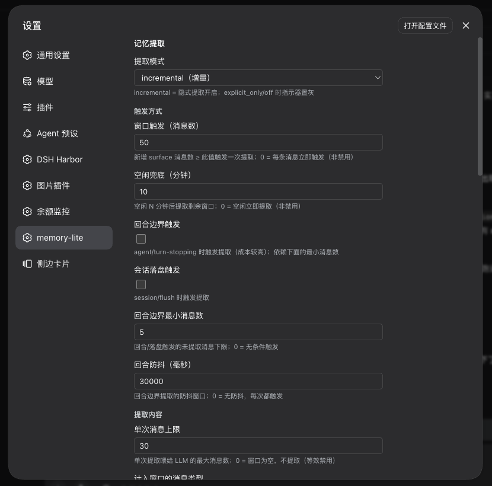
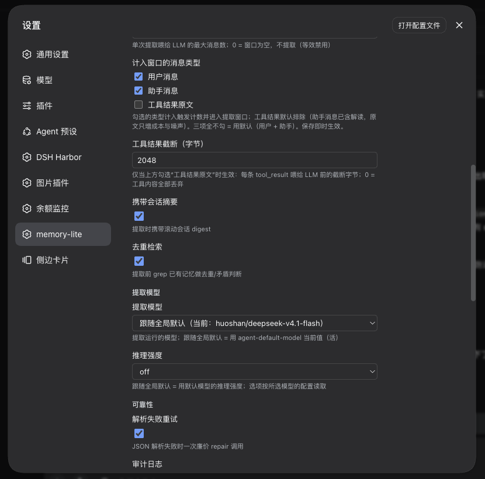

# dsh-memory-lite

English | [简体中文](README.md)

**Cross-session long-term memory for your dsh agent.** Plain Markdown files, zero dependencies: preferences, decisions and constraints from a session survive restarts, upgrades and profile switches.

> Every dsh session starts from a blank page — transcripts are persisted for audit, but the model never sees them again. This plugin adds that layer back: one resident memory catalog + 5 memory tools + background extraction.

<p align="center">
  
</p>

## Quick start (3 steps)

```sh
# 1. Install (= pnpm add inside the profile; the package is added to
#    dsh.profile.bundles automatically)
dsh plugin --profile web add @alanzhao/dsh-memory-lite

# 2. Restart dsh (the host half and the browser half load at boot)

# 3. Verify — the three checks below
```

After installing you should see:

- a `memory-lite` capsule in the session header: **green** = last extraction ok, gray = extraction off, red = last extraction failed
- a full settings page under **Settings → memory-lite** (screenshot below)
- ask the model to remember something ("remember that I use pnpm") — it calls `remember` and a file lands under `~/.agent-memory/peers/<peer>/memories/preferences/` (directories are created on first use)

Compatibility: **dsh ≥ 0.1.5** (full support for dsh 0.2.1-rc.2 specification and engines constraint, seamless integration with Working Directory decoupling and managed Subagent Activation isolation; dual-track compatibility for 0.1.7+ SettingsForms/configForms, backward compatible to 0.1.5), Node ≥ 22.

<p align="center">
  
</p>

## Features

| What | Notes |
|---|---|
| Explicit memory (5 tools) | `read_memory` / `search_memory` / `remember` / `update_memory` / `forget_memory`; `update` archives the previous content into `## History`, `forget` is a soft delete into `.trash/`; `remember` / `update_memory` take a **required** `summary` parameter (a one-line catalog summary, or `"keep"`) — see "Catalog summary consistency" below |
| L0 catalog injection | one resident catalog message per session (rendered from `_index.md`); re-published when the index changes or compaction moves it off the visible surface |
| Implicit extraction | a background run feeds the new conversation window to the model and applies a create / merge / update / skip decision, with dedup search and parse-failure repair; before landing on an existing file the model is shown that file's numbered lines for a reconcile pass (replace / delete / insert / noop) instead of a blind append |
| Cross-peer sharing | mount another peer's memories read-only under `shared/<name>/` |
| Header indicator | capsule + three-state dot in the session header, polling the run status every 10 s |
| Peer isolation | the peer name derives from the session cwd (basename + short hash); cwd-less sessions fall back to `defaultPeer` |

<p align="center">
  
</p>

## What it costs

| When | Cost |
|---|---|
| Every step | the 5 tool schemas are injected (~300–800 tokens) |
| Every session | one resident catalog message, capped at 1200 tokens by default; near-zero incremental cost once the KV cache hits |
| Every explicit remember | one tool call; the index rebuild costs no LLM |
| Every implicit extraction | **one LLM call** (two when the answer needs a repair); when the model gave no summary judgement and the body really changed, **one more small "re-summarize" call**; using your default model or a pinned one |

Default triggers: 50 new conversation messages (`windowTurns`) or 30 minutes idle (`idleTimeoutMin`); turn-boundary and flush triggers are off by default.

> **Tip**: extraction is a structured JSON task and needs no reasoning. Set **reasoning effort = off** — otherwise the model can spend the whole output budget thinking (two calls and 20–80 s per run).

## Configuration

Everything is edited in **Settings → memory-lite** and stored under the `dsh-memory-lite:` section of `~/.dsh/settings.yaml`. Most fields apply on save; `root` and `sharing.*` need a restart.

| Group | Field | Notes |
|---|---|---|
| Extraction | Mode | `incremental` (default, implicit extraction on) / `explicit_only` / `off` |
| Triggers | Window turns | one run once this many new messages accumulate; default 50; 0 = trigger on every message (not a disable) |
| | Idle timeout (min) | extract the remaining window after N idle minutes; default 30 |
| | Turn-boundary / flush triggers | off by default (more expensive) |
| | Min messages / debounce | thresholds for the two triggers above |
| Content | Max messages | most messages fed to the model per run; default 20 |
| | Message scope | default user + assistant; raw tool results excluded (cost and noise only); all three unchecked = the default |
| | Tool-result truncation (bytes) | only used when "tool results" is checked |
| | Include digest / dedup search | both on by default |
| Model | Extraction model | follows the live global default model unless pinned to a provider/model |
| | Reasoning effort | read from the selected model's declaration; **off is recommended** |
| Reliability | Parse retry | one cheap repair call when the answer is not valid JSON (on by default) |
| Reconcile | `extraction.reconcile` | before a merge / update lands on an existing file, show the model its numbered Current lines and let it answer with line edits or noop; falls back to append on failure. On by default; one extra call per merge / update |
| | `extraction.reconcileMaxBytes` | byte budget for the numbered Current shown to the reconcile call, default 24576; larger files skip reconcile and append |
| History | `history.maxEntries` / `entryMaxChars` | keep only the newest N History lines per file (default 5), each at most M characters (default 240). Set in `cordis.patch.yml` only, **restart to apply** |
| | `history.archiveKeep` | save the whole previous file as a snapshot before every update / patch (newest 5 kept by default, 0 = off). **Restart to apply** |
| | Audit log | writes `peers/{peer}/sessions/{session-id}.json` and `extraction.log` |
| Catalog | Token cap | L0 catalog cap (default 3500): full expansion under cap, adaptive Topic Map over cap |
| | `index.hotBudgetRatio` | share of post-preferences budget given to expanded hot topics (default `0.7`) |
| UI | Indicator order | header utilities slot order; refresh the page after saving |
| Storage & Privacy | Memory root | `~/.agent-memory` by default, **restart to apply** |
| | Hide private (`privacy.hidePrivate`) | one-click screen-share shield hiding `private/` everywhere (live) |
| | Private namespace (`privacy.namespace`) | top-level directory for sensitive topics (default `private`, live) |
| | Restricted exits (`privacy.restrictedProviders` / `restrictedPaths`) | automatically hides & blocks `private/` whenever using restricted providers or directories |
| | Forced private paths (`privacy.privatePaths`) | optional safety net forcing writes/extractions under matching cwds into `private/<subtopic>` |

Full schema and defaults: [`src/config.ts`](https://github.com/alanzhao0128/dsh-memory-lite/blob/main/src/config.ts).

## What the memory looks like

```
~/.agent-memory/
├── AGENTS.md                       # global agent charter (optional, injected everywhere)
├── memories/
│   ├── _index.md                   # unified L0 topic index (generated; hand-editable)
│   ├── preferences/                # always-expanded cross-topic preferences
│   ├── infra/  dsh/  g7/  video/   # public topic folders (1 level)
│   └── private/                    # trust boundary: hidden in restricted mode, connected in personal mode
│       ├── health/  insurance/     # sensitive subtopics (2 levels)
│       └── family/  quant/
├── .history/{topic}/{slug}.md/     # full pre-change snapshots
├── sessions/                       # unified extraction checkpoints + audit + extraction.log
├── topic-affinity.json             # auto-learned cwd <-> topic affinity for adaptive expansion
└── .trash/                         # soft-deleted memories (dated folders)
```

Each memory file uses `## Current` / `## History` / `## Related`. Before an update the complete previous file is saved under `.history/`, and `## History` itself keeps only the newest few one-line notes instead of piling up old bodies. The catalog summary describes the whole file, and every body change gets an explicit summary judgement (next section). The four categories are retrieval paths for the model: preferences (always relevant), entities (mentioned knowledge), events (time-related), experiences (task lessons).

### Catalog summary consistency

The one-line summary of each file in `_index.md` no longer goes quietly stale after the body changes: **every body change gets exactly one explicit judgement of the summary** — either `keep` (the current summary is still fully accurate) or new text. Three layers enforce it:

1. **Explicit tools (`remember` / `update_memory`)**: `summary` is a required parameter — a new one-line summary, or `"keep"`. A missing/blank value throws **before any write** (`remember` creating a new file also rejects `keep`: a new file has no old summary to keep). The tool result gains an `Index summary: kept «…»` or `Index summary: «old» → «new»` line so the call can be checked on the spot.
2. **Implicit extraction**: `update` decisions and reconcile patches must carry `summary` (`keep` or new text); the reconcile prompt now shows the file's current catalog summary. `create` still requires a summary.
3. **Fallback (re-summarize)**: when the extractor omits the judgement it **never rejects or rolls back the body write**; the body is written as usual and a small extra call judges the summary on its own. If that call also fails, the summary is suffixed with ` ⚠stale` — "body changed, summary not confirmed".

`⚠stale` is a visible marker, not a silent state: the next extraction that touches the file shows it to the reconcile/re-summarize prompt, and once the model answers `keep` or rewrites it the marker is cleared; you can also edit `_index.md` by hand. The mechanism guarantees a judgement per change, not that the judgement is right (a model can still wrongly pick `keep`), which is why the output is made visible. `extraction.log` gains `summaryResummarized` (re-summarize calls) and `summaryStaleMarked` (files flagged), and a failed re-summarize is recorded in `failed-answers.log` with `stage: "summary"`.

## How it works (short version)

- **Catalog injection**: in the `agent/pre-step` waterfall the peer's `_index.md` is rendered into one `user/message` carrying the official `plugin` source kind with the `catalog` form; subagent sessions get none.
- **Extraction**: triggered by `windowTurns` or idle → select the window → grep existing memories for dedup → one LLM decision → (when it lands on an existing file) a second LLM reconcile call that sees the file's numbered lines and answers with replace / delete / insert / append or noop; out-of-range lines, heavily shortened lines and mass deletions are rejected and fall back to append → write files → settle the catalog summary (one extra re-summarize call when needed) → advance the per-session bookmark. **A failed run keeps the bookmark**, so the same window is retried on the next trigger.
- **Safety**: every file access goes through a containment boundary (relative paths only; `..`, absolute paths and symlink escapes are rejected at the executor).
- **Concurrency**: all writes go through a serial queue with atomic tmp+rename replacement.

Details (design tradeoffs, incident notes, known deviations) live in [`IMPLEMENTATION.md`](https://github.com/alanzhao0128/dsh-memory-lite/blob/main/IMPLEMENTATION.md).

## Troubleshooting

| Symptom | What to do |
|---|---|
| Nothing happens after installing; the model has no memory tools | **Restart dsh**; check that `dsh plugin --profile web ls` lists the package and that it is in `dsh.profile.bundles` |
| No memory-lite capsule in the header | Refresh the page; the slot lives in the header utilities row (order is configurable) |
| The capsule is red | The last extraction failed: read the `note` of the last line in `~/.agent-memory/peers/<peer>/sessions/extraction.log` |
| Extraction never fires | Check, in order: extraction mode, window turns, message scope, max messages (0 = nothing is extracted) |
| The log says `no configured model`, or the panel shows 已失效 (stale) | The extraction model was renamed or removed — pick another one |
| Extraction is slow / always `parse-error-recovered` | Reasoning effort is eating the output budget: set it to off |
| Memories land under the wrong peer | The peer derives from the session cwd; cwd-less sessions use `defaultPeer` (configurable) |

## Uninstall

```sh
dsh plugin --profile web remove @alanzhao/dsh-memory-lite
# restart dsh
```

Your memories are not deleted: `~/.agent-memory` is left for you to keep or remove.

## Known limits

- `forget_memory` has no approval gate (the model can soft-delete directly).
- `## Related` auto-maintenance is not implemented.
- No CLI / MCP entry point.
- The browser half (indicator + settings page) needs the web profile's `connection` service; under a headless profile the plugin still loads (tools + extraction work) and simply has no browser surfaces.
- Extraction quality depends on the model you pick; small models produce JSON that needs repair more often.

## Changelog

### v2.0.0 (2026-11-24)
- **Catalog summaries can no longer silently go stale (hard guarantee)**: every body change gets one explicit summary judgement (`keep` or new text); a failed judgement leaves a visible `⚠stale` marker.
- **Breaking — tool parameters**: `remember` and `update_memory` gain a **required** `summary` parameter (a one-line catalog summary, or `"keep"`). A missing/blank value throws before any write; `remember` cannot pass `keep` when it creates a new file. Callers/prompts built against the old parameter set must be updated. Results gain `summary: { before?, after, action: 'kept' | 'changed' }` and an `Index summary:` render line.
- **Implicit extraction**: `update` decisions and reconcile patches must carry `summary` (`keep` / new text), and the reconcile prompt gets a "Current catalog summary" section; a missing judgement triggers one extra re-summarize LLM call (`resummarize`), and if that fails the summary is flagged `⚠stale` — a missing summary never rejects or rolls back the body write. Append paths (merge without reconcile / reconcile fallback / create colliding with an existing file) always re-summarize.
- New metrics `summaryResummarized` / `summaryStaleMarked` (`extraction.log`); failed re-summarizes land in `failed-answers.log` (`stage: "summary"`).
- New `src/summary.ts` and `MemoryStore.readIndexEntry` / `applySummaryVerdict` / `markIndexStale` (all serialized through the mutation queue); `appendCurrent` now resolves whether the body changed.

### v1.0.0 (2026-11-22)
- **Unified Topic Vault**: replaces directory-hashed `peers/` and `sharing.mounts` with one human-readable `~/.agent-memory/memories/<topic>/` tree so cross-directory tasks and cross-topic links (e.g. insurance ↔ health) connect with zero manual sharing rules.
- **Adaptive two-tier L0 catalog (KV-cache friendly)**: expands all visible memories under `index.maxTokens` (default `3500`), and seamlessly switches to `preferences/` + auto-learned `topic-affinity.json` hot topics + 1-line collapsed Topic Map above the cap, pinning per-session hot order to protect prompt cache.
- **Hard trust-boundary gate (`privacy`)**: adds a `private/<subtopic>` namespace enforced across L0 injection, all 5 tools, and background extraction (checking both session and extraction model providers) via `hidePrivate`, `restrictedProviders`, `restrictedPaths`, and optional `privatePaths` safety nets.
- **Tool upgrades**: `read_memory("<topic>/")` lists entries of collapsed topics; `search_memory(query, topic?)` searches filenames, summaries, and bodies with optional topic filtering; checkpoints & logs consolidate under `~/.agent-memory/sessions/`.

### v0.5.2 (2026-11-21)
- **Collapse stacked bullets**: incoming lines with stacked markers (`- - x`, `  - * x`, `1. - x`) keep only the first marker (→ `- x` / `  - x` / `1. x`); negative numbers like `-1` and `- 1. step` are untouched. Applies to merge / create / update and reconcile patch insert / append.
- **Drop empty entries**: marker-only lines (`-`, `- -`, `* `, `1.`) are no longer written; previously a lone `-` became `- -`. `lineKey` now treats them as empty too.
- Existing nested lines are left as they are (no automatic rewrite). Thanks to #1 for the root-cause analysis and #2 for the approach.

### v0.5.1 (2026-11-15)
- **Higher extraction output budget & truncation guard**: bumped `EXTRACTION_MAX_TOKENS` from `4096` to `32768` so reasoning models and the `reconcile` pass do not exhaust the budget on heavier windows; `collectStream` now also rejects `finish.kind === 'max-tokens'` as an explicit `llm-error` instead of letting truncated JSON enter tolerant parsing or repair.

### v0.5.0 (2026-11-13)
- **No more nested bullets**: lines that already carry `-` / `1.` / `#` / table / indentation keep their shape; only plain lines get a `- `. Duplicate detection now ignores list markers.
- **Capped History**: only the newest `history.maxEntries` lines survive, each truncated; the full previous file goes to `peers/{peer}/.history/` (never searched or injected), pruned by `history.archiveKeep`.
- **Stable catalog summaries**: `create` asks the extractor for a one-sentence `summary`; `merge` / `remember` appends no longer overwrite an existing summary; `update` may carry a new one.
- **Reconcile**: merge / update / create onto an existing file costs one extra LLM call in which the model sees the file's numbered lines and answers with line edits or noop; a rejected patch or failed call falls back to append (with reconcile on, an update is no longer a blind whole-file replace). Turn off with `extraction.reconcile: false`.
- Audit entries and `extraction.log` gain the outcomes `patch` / `noop`, plus a `reconcileFallback` field when reconcile gave up.

### v0.4.1
- **DSH 0.2.1-rc.2 Specification & Engines Alignment**: Declared `"engines": { "dsh": ">=0.1.2-rc.1" }` in `package.json`, adhering to the official priority evaluation of `engines.dsh`.
- **Fixed Volatile Reference Validation Bug**: Resolved `ValidationError` during `installSettingsCompat` by cleanly unwrapping volatile references with `unwrapConfig`.
- **L0 Catalog Category Priority & Anti-Truncation**: Enforced stable output priority in `renderIndex` (`preferences -> entities -> experiences -> events`) and expanded default `index.maxTokens` to 2000, preventing core rules and assets from being dropped by token budgets.
- **Triple Gate for Background Extraction**: Overhauled `extractionSystem` with a strict negative exclusion list, 30-day durability test, and aggressive merge requirement to eliminate over-extraction and memory fragmentation.

## Development

```sh
npm install
npm run build     # tsc -> lib/
npm test          # node:test + tsx, including a real Loader boot smoke test
```

## License

MIT
